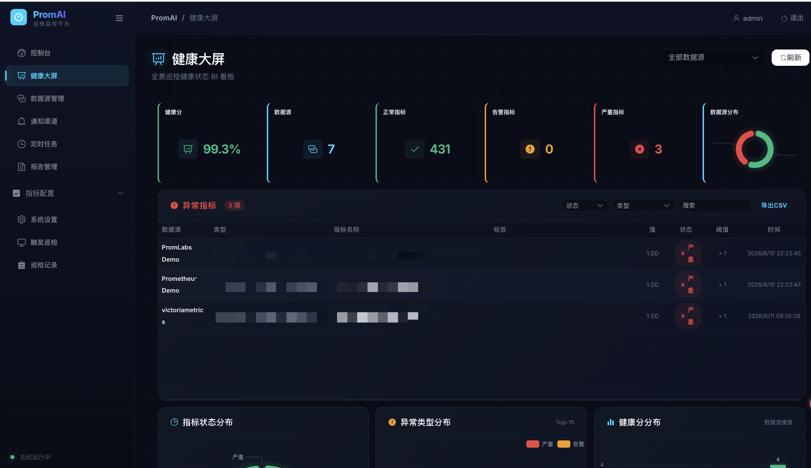
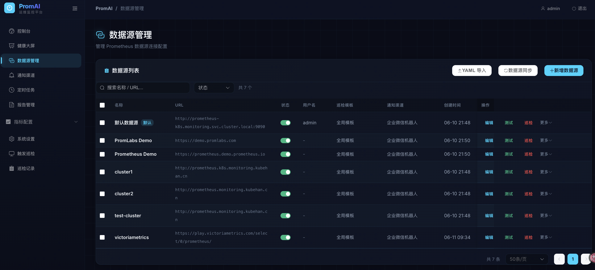
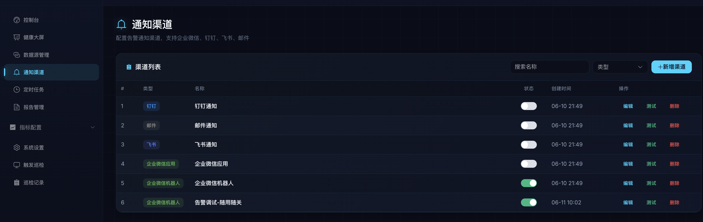
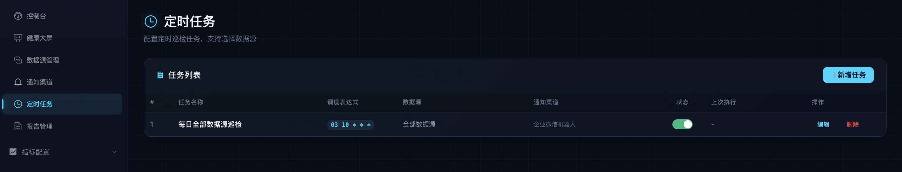
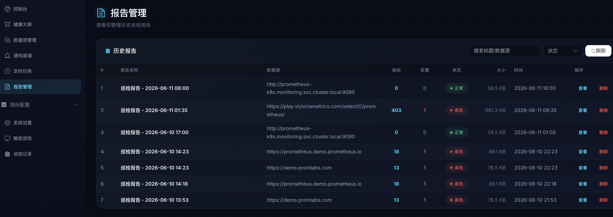
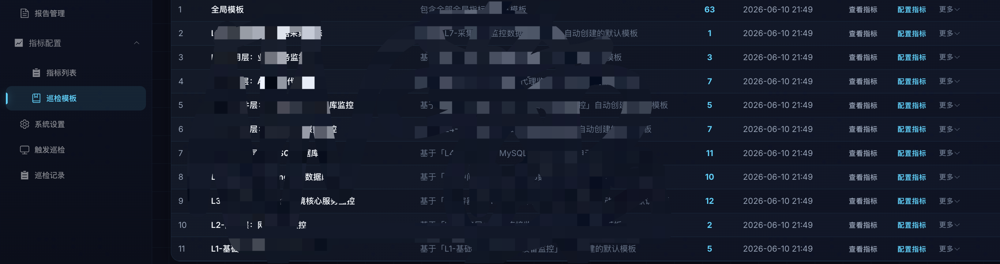
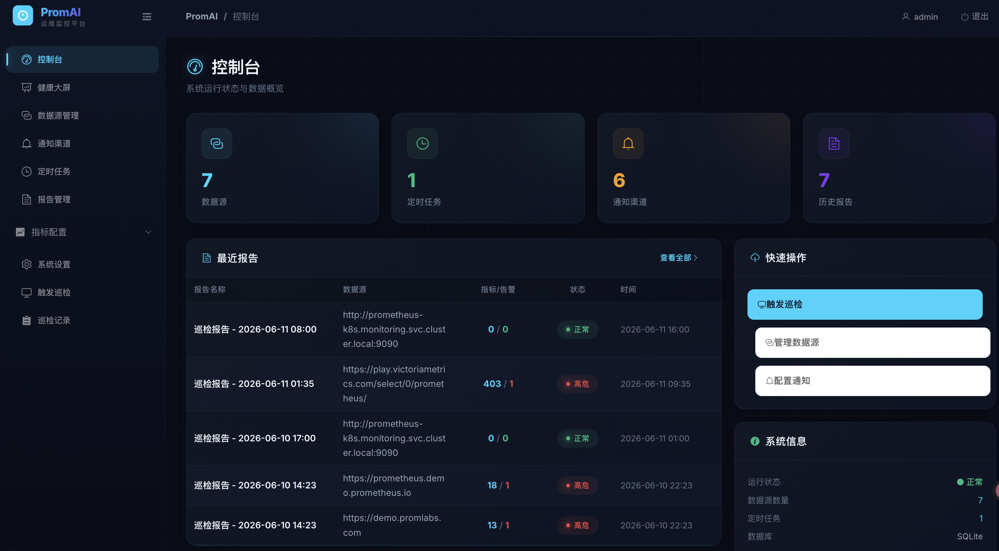

# Prometheus 监控报告生成器

> Prometheus Automated Inspection

## 项目简介

基于 Prometheus 的监控巡检工具，支持自动采集指标、生成可视化 HTML 报告，并提供 **Web 管理后台**（SQLite 持久化）进行数据源、指标、模板、定时任务、通知渠道的全生命周期管理。

## 效果展示









## 快速开始

### 源码编译

1. 克隆仓库：

   ```bash
   git clone https://github.com/kubehan/PromAI.git
   cd PromAI
   ```

2. 安装依赖：

   ```bash
   go mod download
   cd frontend && npm install && cd ..
   ```

3. 修改配置文件 `config/config.yaml`，设置 Prometheus 地址

4. 构建前端 + 后端：

   ```bash
   cd frontend && npm run build 
   cd ..
   go build -o promai .
   ```

5. 运行：

   ```bash
   ./promai
   ```

   首次运行自动从 `config/config.yaml` 导入种子数据到 SQLite。

### 访问地址

| 用途 | 地址 |
|------|------|
| 首页 | http://localhost:8091/promai |
| 健康大屏（BI） | http://localhost:8091/promai/bi |
| 巡检报告 | http://localhost:8091/promai/reports |
| 触发巡检 | http://localhost:8091/promai/inspection/ |

### Helm 部署

```bash
helm install promai ./deploy/helm/promai \
  --set image.repository=promai \
  --set image.tag=v2.0.3
```

升级：

```bash
helm upgrade promai ./deploy/helm/promai \
  --set image.repository=promai \
  --set image.tag=v2.0.3
```

常用配置：

```yaml
env:
  reportUrl: "https://promai.example.com"
bootstrapSql:
  enabled: true
  content: |
    -- 自定义初始化 SQL
```

说明：
- `env.reportUrl` 用于生成报告外链，推荐配置成外部可访问地址。
- `deploy/helm/promai/files/metric_types_seed.sql` 是默认初始化 SQL。
- 如果需要自定义初始化内容，直接改 `bootstrapSql.content` 或替换 `files/metric_types_seed.sql`。

## 管理后台功能

| 页面 | 功能 |
|------|------|
| **控制台** | 系统概览，数据源/报告/模板/通知数量统计 |
| **健康大屏** | ECharts 图表展示各数据源健康评分、指标分布、告警统计 |
| **数据源管理** | 添加/编辑/删除 Prometheus 数据源，绑定巡检模板 |
| **指标配置** | 管理指标类型和 PromQL 配置，按数据源筛选，PromQL 验证 |
| **巡检模板** | 创建巡检模板，绑定指标，支持指标级别覆盖（不影响全局） |
| **通知渠道** | 配置钉钉、企业微信、飞书、邮件等通知方式 |
| **定时任务** | Cron 表达式定时巡检，选择通知渠道自动告警推送 |
| **触发巡检** | 手动触发巡检，支持选择数据源、指标、模板 |
| **报告管理** | 查看/删除历史巡检报告 |
| **系统设置** | 项目名称、调度 Cron、报告清理策略等 |

## 配置说明（config/config.yaml）

仅用于首次启动时的种子数据导入，后续所有配置通过管理后台 UI 操作，持久化在 SQLite。

```yaml
prometheus_url: "http://prometheus.k8s.kubehan.cn"
project_name: "PromAI"
cron_schedule: "00 08,17 * * *"

data_sources:
  - name: "cluster1"
    url: "http://prometheus.cluster1.example.com"
```

## 多数据源

通过管理后台「数据源管理」页面添加，每个数据源可独立绑定不同的巡检模板。

## 已实现的核心功能

- ✅ 多数据源支持
- ✅ SQLite 持久化（GORM）
- ✅ 巡检模板系统（模板指标覆盖）
- ✅ 智能告警（警告、严重两级告警）
- ✅ 管理后台 SPA（Vue 3 + Element Plus）
- ✅ 健康大屏（ECharts）
- ✅ 定时巡检（Cron 表达式）
- ✅ 多渠道通知（钉钉、企微、飞书、邮件）
- ✅ 数据导出（HTML 报告）
- ✅ PromQL 在线验证
- ✅ 响应式设计

## 许可证

该项目采用 MIT 许可证，详细信息请查看 LICENSE 文件。

## 未来功能开发计划

> 详细设计请参考：[PromAI-AIOps-WebTerminal-设计开发文档](docs/PromAI-AIOps-WebTerminal-设计开发文档.md)

### 阶段一：AI-Chat Web终端核心（最关键能力）【优先】
- [ ] **安全 SSH 登录** - 主机白名单、密钥/密码认证（优先密钥）、凭据 AES-256-GCM 加密存储
- [ ] **Web 终端渲染（xterm.js）** - 类原生终端体验、多窗口多标签、交互式程序兼容（vim/top/less/tail -f）
- [ ] **命令审批（Command Approval）** - 高危命令拦截、审批队列、按环境/角色策略、一次性放行、超时自动拒绝
- [ ] **全量审计日志** - 登录、执行、审批、分享等全量留痕，**仅增不改**（不可篡改）
- [ ] **会话录制与回放** - asciicast v2 格式录制、倍速回放、暂停跳转

### 阶段二：会话分享、AI 总结与故障联动【优先】
- [ ] **会话分享（Session Sharing）** - 只读临时分享链接、过期时间、访问次数限制、可撤销
- [ ] **AI 排查总结（AI Summary）** - 脱敏精简上下文，基于 pi-agent 生成结构化总结（排查过程、关键发现、遗留风险、建议）
- [ ] **AI 协同助手** - 自然语言转 Shell 命令、命令解释、风险提示、异常分析
- [ ] **故障联动** - 从故障单一键进入终端、会话关联故障单、AI 总结自动附加到故障时间线

### 阶段三：AIOps 基础（事件中心与故障管理）
- [ ] **统一事件中心（Event Hub）** - 告警事件标准化、事件列表、过滤、批量合并、转故障单
- [ ] **故障管理（Incident）** - 故障单全生命周期（创建、认领、处理、缓解、解决、关闭）、状态流转校验
- [ ] **故障时间线（Timeline）** - 操作轨迹全量记录、审计追溯
- [ ] **MTTA/MTTR 统计** - 平均确认时间、平均修复时间自动计算

### 阶段四：告警关联、拓扑与 CMDB
- [ ] **告警关联引擎（Correlation）** - 基于时间窗口、标签交集自动聚合，告警收敛降噪
- [ ] **CMDB（配置项管理）** - 应用/服务/主机等配置项维护、标签管理
- [ ] **服务拓扑（Topology）** - 依赖关系可视化、故障节点高亮、影响面分析
- [ ] **变更事件管理（Change）** - 发布/配置变更记录，纳入 AI-RCA 上下文

### 阶段五：AI-RCA、知识库、值班、驾驶舱与安全加固
- [ ] **AI 根因分析（AI-RCA）** - 结合拓扑、告警、变更、指标、历史故障自动分析，生成疑似根因、影响面、建议处置
- [ ] **知识库（Runbook）** - Markdown 编辑、适用条件匹配、使用统计、故障推荐
- [ ] **值班管理（OnCall）** - 排班日历、当前值班查询、值班路由
- [ ] **AIOps 驾驶舱** - 核心 KPI（活跃故障、MTTA/MTTR、告警收敛率）、趋势图表
- [ ] **安全加固与测试** - 并发限制、空闲超时、WSS/Origin 校验、权限细化、全量安全测试

### 设计原则
- **安全优先**：Web 终端所有安全能力（白名单、凭据加密、命令审批、审计）优先建设并验收
- **渐进演进**：增量扩展，复用现有告警、AI、通知模块，最大程度向后兼容
- **AI 原生**：深度整合 pi-agent，实现从"告警"到"AI 辅助排查"到"经验沉淀"的闭环
- **最小可行**：先打通核心闭环（事件->故障->终端排查->AI 总结），再逐步完善高级能力
- **全量可审计**：终端操作、故障流转等关键行为全量留痕，满足企业运维合规要求
